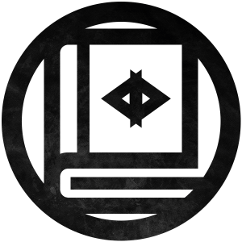

# Hush House



> **Hush House is an unofficial fan work set in Weather Factory's Sixth History.** It is not
> affiliated with or endorsed by Weather Factory Ltd, and is published under Weather Factory's
> [Sixth History Community Licence](https://weatherfactory.biz/sixth-history-community-licence/).
> You can find out more and support the Secret Histories at
> [www.weatherfactory.biz](https://www.weatherfactory.biz).

Hush House is a desktop app that runs a household of AI coding agents on your own computer.
Each agent is a real command-line agent, such as Claude Code or Codex, running in its own
terminal. They share a memory, pass each other messages, and take work from one orchestrator, the
agent you talk to. You watch them at their desks in the Study, read any terminal, and type into
any session.

It is free and open source, and nothing is sold. The agents run on your machine, in your folders,
and talk only to the model providers you already use.

## What it does

- **Runs the agents you already have.** Claude Code, Codex, Gemini CLI, Antigravity, GitHub
  Copilot, Cursor, Grok, Kimi Code, Qwen, OpenCode, Crush, pi, or any custom command. Each runs as
  a normal process in a pseudo-terminal, under your own subscription or API key. Local models work
  through Ollama, LM Studio or vLLM.
- **Coordinates them through a shared folder.** The agents work in a local folder of plain files
  called the hive. Each agent writes to its own outbox, and the app delivers messages into the
  other agents' inboxes. The orchestrator assigns work and asks you only about the things that
  need you.
- **Remembers between sessions.** Every agent keeps markdown notes, and a search index lets any
  agent recall what the others learned.
- **Shows the work.** Agents appear as portrait cards in the Study. Each card shows what that
  agent is doing. A built-in editor shows each agent's files and git history.

The design of the hive is in [`HIVE.md`](./HIVE.md), the terminal and event planes in
[`SPEC.md`](./SPEC.md), the code layout in [`docs/ARCHITECTURE.md`](./docs/ARCHITECTURE.md), and
the visual system in [`DESIGN.md`](./DESIGN.md).

## Run it

There are no packaged releases yet, so Hush House runs from source. Updates are turned off in
this build: pull the repository to get a newer version.

### You need

- macOS, Windows or Linux.
- Node.js 18 or newer, with npm.
- A C/C++ toolchain, for `node-pty`'s native addon. On macOS, run `xcode-select --install`.
- At least one supported agent CLI on your `PATH`. Claude Code (`claude`) is the default.

### Start the app

```bash
git clone https://github.com/aaroncoville/munder-difflin.git hush-house
cd hush-house
npm install        # also rebuilds node-pty for Electron
npm run dev        # starts the app
```

On first launch, a short setup asks where the hive folder should live and which agent to use as
the orchestrator. Then use **Add agent** to start your first agent.

### Other commands

```bash
npm run build          # production build
npm run typecheck      # type-check the main process and the interface
npm run test:focused   # the test suite
```

If `node-pty` fails to load after an Electron upgrade, run `npm install` again.

### Where your data lives

Settings, the agent database and usage history are kept in the app's data folder. The folder
keeps its original name, `munder-difflin`, so existing installs carry on where they left off:

| OS | Folder |
| --- | --- |
| macOS | `~/Library/Application Support/munder-difflin` |
| Windows | `%APPDATA%\munder-difflin` |
| Linux | `~/.config/munder-difflin` |

The hive itself lives wherever you chose during setup.

## Contributing

See [`CONTRIBUTING.md`](./CONTRIBUTING.md). In short: keep `npm run typecheck` at zero errors,
add a test that fails without your change, and build any new interface from the tokens in
[`DESIGN.md`](./DESIGN.md). Report security problems as [`SECURITY.md`](./SECURITY.md) describes,
not in a public issue.

## Telemetry

What the app may send, and how to turn it off, is documented in [`TELEMETRY.md`](./TELEMETRY.md).

## Licence

The source code is under the MIT License; see [`LICENSE`](./LICENSE). Hush House is built on the
open-source Munder Difflin project by Chaitanya Giri, whose copyright notice the licence keeps.

The bundled fonts and the Sixth History logo carry their own licences, listed in
[`src/renderer/src/assets/ATTRIBUTION.md`](./src/renderer/src/assets/ATTRIBUTION.md). The Study's
setting, portraits and logo are used under Weather Factory's Sixth History Community Licence; how
each of its conditions is met is recorded in
[`ATTRIBUTION-SIXTH-HISTORY.md`](./src/renderer/src/assets/sixth-history/ATTRIBUTION-SIXTH-HISTORY.md).
